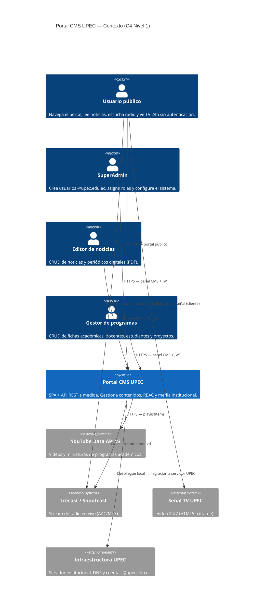
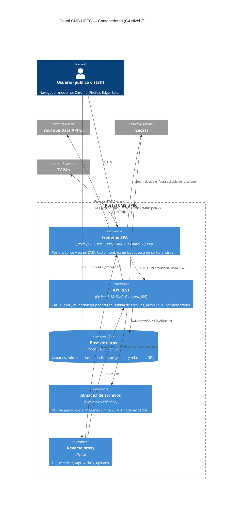
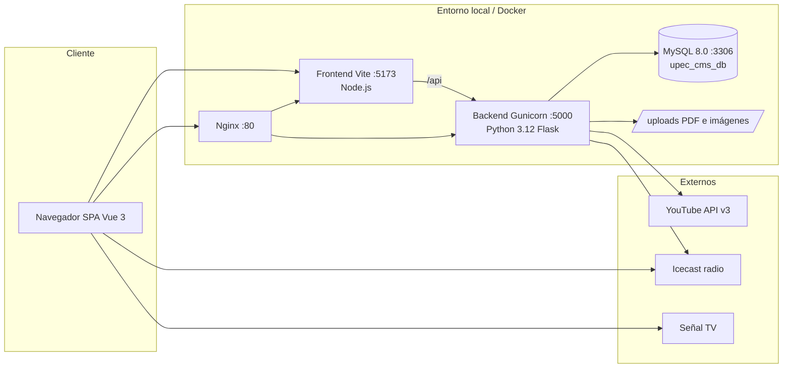
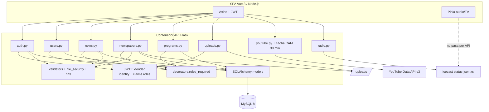
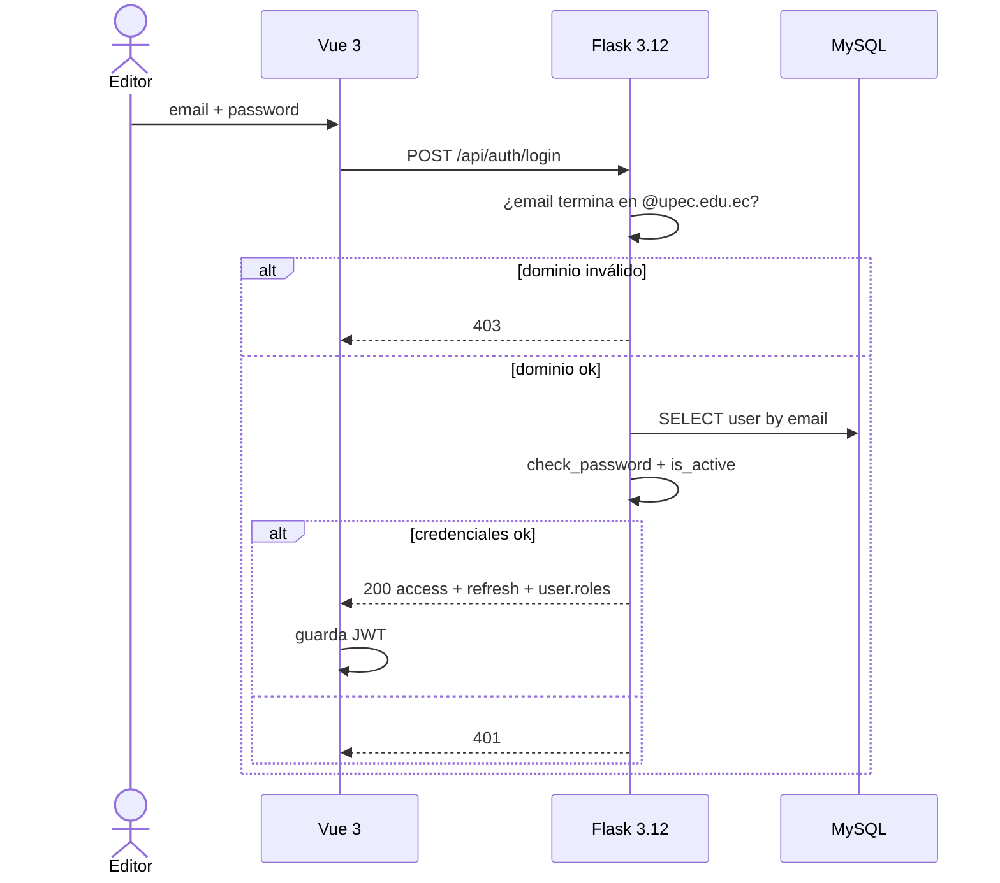
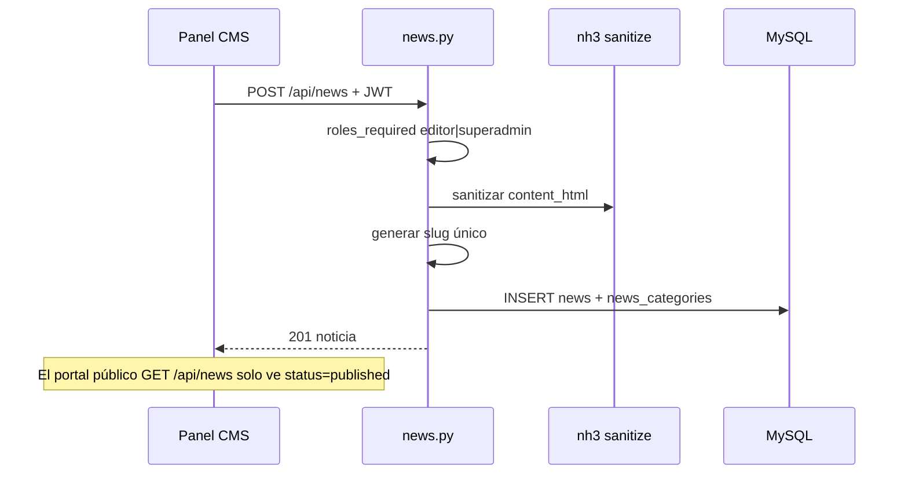
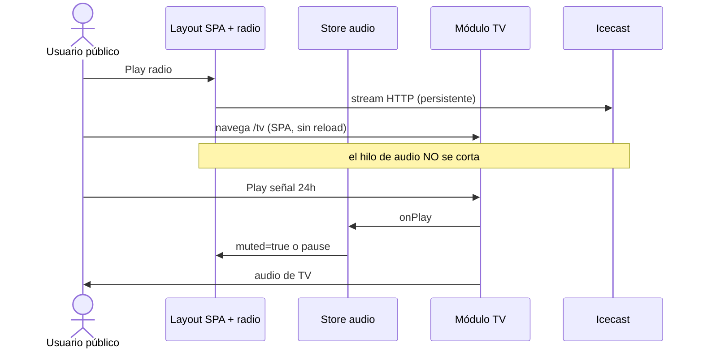

# 2.1 Diseño de arquitectura (C4) — Portal CMS UPEC

**Proyecto:** Portal Web Institucional y CMS a medida (Canales Digitales UPEC)  
**Stack fijado:** frontend con **Node.js** (Vue 3 + Vite) y backend con **Python 3.12** (Flask).  
**Herramienta de IA:** Cursor (sesión de diseño sobre requisitos REQ/RF y el código del repositorio).  
**Alcance:** C4 Nivel 1 (Contexto), Nivel 2 (Contenedores), Nivel 3 (componentes del API), secuencias de login/noticia/TV-radio, y bitácora IA vs. decisión humana.

---

## Prompt usado con la IA

```
Diseña la arquitectura C4 (contexto y contenedores) de un CMS a medida para UPEC.
Restricciones:
- NO usar WordPress/Joomla ni plantillas comerciales.
- Frontend SPA (radio Icecast no debe cortarse al navegar).
- Backend API REST en Python 3.12.
- Frontend Node.js (Vue 3 + Vite).
- BD relacional institucional (MySQL).
- Login solo @upec.edu.ec, JWT, roles SuperAdmin / Editor / GestorProgramas.
- Integración YouTube Data API v3 y stream Icecast/TV.
Entrega: diagrama C4, responsabilidades, interfaces y justificación de cada decisión.
```

---

## C4 Nivel 1 — Contexto del sistema

El **Portal CMS UPEC** es el sistema de software que expone el portal público (noticias, programas, radio, TV) y un panel administrativo privado. Los actores humanos y sistemas externos interactúan así:



### Actores e interfaces de contexto

| Actor / sistema | Tipo | Interfaz | Responsabilidad |
|---|---|---|---|
| Usuario público | Persona | SPA en navegador | Consumir contenido publicado, radio y TV |
| SuperAdmin | Persona | SPA `/admin` + API JWT | Usuarios, roles, auditoría de acceso |
| Editor | Persona | SPA `/admin` + API JWT | Noticias y periódicos PDF |
| Gestor de programas | Persona | SPA `/admin` + API JWT | Directorio académico |
| YouTube API v3 | Externo | REST JSON | Miniaturas y VideoID por playlist/canal |
| Icecast | Externo | Stream + JSON status | Audio en vivo; el CMS no retransmite el audio |
| TV UPEC | Externo | HTML5 / iframe | Video 24/7; interlock mute/pause de radio en el cliente |
| Infra UPEC | Externo | MySQL, archivos, env | Persistencia institucional y despliegue escalonado |

---

## C4 Nivel 2 — Contenedores



Diagrama de despliegue local (REQ-011) con las mismas piezas:



---

## Componentes internos y responsabilidades

### Frontend SPA (`frontend/`, Node.js)

| Componente | Responsabilidad | Interfaz |
|---|---|---|
| Vue Router (SPA) | Cambio de vista **sin recargar** el documento | Rutas `/`, `/noticias`, `/programas`, `/tv`, `/admin/*` |
| Layout + reproductor radio | Hilo de audio persistente (RF-007) | Componente fuera del `<router-view>` |
| Store Pinia (audio) | Interlock TV/Radio (RF-008): `onPlay` TV → `muted/paused` radio | Evento global de estado |
| Vistas públicas | Consumen endpoints GET públicos | Axios → `/api/news`, `/programs`, `/newspapers`, `/youtube/latest`, `/radio/status` |
| Panel CMS | Formularios CRUD + TipTap (HTML sanitizado en servidor) | JWT en `Authorization: Bearer` |
| Branding | Paleta UPEC `#006633` / `#FFCE00`, responsive | CSS/Tailwind |

### Backend API (`backend/`, Python 3.12)

| Blueprint | Prefijo | Responsabilidad |
|---|---|---|
| `auth` | `/api/auth` | Login dominio institucional, refresh, `/me`, logout (blocklist JWT) |
| `users` | `/api/users` | CRUD usuarios — solo SuperAdmin |
| `news` | `/api/news` | Listado público publicado + CRUD editor/superadmin |
| `newspapers` | `/api/newspapers` | PDF del periódico digital |
| `programs` | `/api/programs` | Fichas + docentes/estudiantes/proyectos |
| `uploads` | `/api/uploads` | Imágenes y PDF validados |
| `youtube` | `/api/youtube` | Caché de playlist institucional |
| `radio` | `/api/radio` | Metadatos Icecast (no el bitstream de audio) |

Middleware de autorización: `roles_required(...)` lee claims JWT (`roles`) y responde **403** si el rol no aplica.

### Datos y archivos

- **MySQL 8:** fuente de verdad relacional (ver `02-modelo-datos.md`).
- **Filesystem `uploads/`:** PDF e imágenes; la BD guarda URL, tamaño y metadatos, no el binario BLOB (evita inflar InnoDB).

---

## Decisiones arquitectónicas (con apoyo de IA)

| Decisión | Opción elegida | Por qué | Qué sugirió la IA y qué se rechazó |
|---|---|---|---|
| Estilo | SPA + API REST (no monolito SSR) | RF-007 exige radio continua; un full reload corta Icecast | La IA propuso Next.js/Nuxt SSR “por SEO”; se rechazó como arquitectura **principal** porque recarga o hidratación agresiva rompe el hilo de audio. SEO se cubre con HTML inicial mínimo + metadatos, no con recarga por página. |
| Frontend | **Node.js** + Vue 3 + Vite | SPA liviana, ecosistema ya presente en el repo | La IA ofreció React; el equipo unificó Vue porque el prototipo ya usa Vue Router/Pinia/TipTap. |
| Backend | **Python 3.12** + Flask + Gunicorn | Requisitos de práctica (Python Manager 3.12) y API REST clara | La IA sugirió FastAPI “por defecto”. Se mantuvo Flask porque el código, JWT y blueprints ya están en Flask 3.1; migrar no aporta valor al diseño. |
| Persistencia | MySQL 8 + SQLAlchemy | BD institucional relacional (REQ-010), UTF8MB4 | La IA sugirió MongoDB para “listas de docentes”. Se rechazó: listas son relaciones 1:N, no documentos. |
| Auth | JWT access 1 h + refresh 30 d | Stateless para SPA; claims con roles | La IA metió sesiones Flask en cookie. Incompatible con SPA y CORS limpio. |
| Radio | Stream **directo** navegador ↔ Icecast; API solo *now playing* | El backend no debe ser cuello de botella de audio | La IA propuso proxy del stream por Flask. Se rechazó: latencia, CPU y un solo punto de fallo. |
| YouTube | Consulta servidor + caché 30 min | Protege API Key y cuota | La IA puso la API Key en el frontend. Se rechazó (secreto expuesto). |
| CMS | Código a medida | REQ-002 | La IA ofreció Strapi/WordPress headless. **Prohibido.** |
| Despliegue | Docker Compose local → Nginx en servidor UPEC | REQ-011, variables de entorno | La IA generó Kubernetes. Sobreingeniería para el alcance académico/institucional inicial. |

---

## Cómo contribuyó la IA y dónde se corrigió

**Aportes útiles**

- Estructuró el C4 en actores + contenedores a partir de REQ-001 a REQ-011.
- Separó correctamente “quién consume el stream” (navegador) vs. “quién consulta metadatos” (API).
- Recordó CORS, JWT en header y saneamiento HTML en el servidor.

**Correcciones humanas (obligatorias para la rúbrica)**

1. **Rechazo de CMS prefabricado** que la IA insistía en “acelerar el MVP”.
2. **Normalización de Programas:** la IA dejaba `lista_docentes` como JSON en una sola tabla (eso se corrige en 2.2).
3. **No proxyar Icecast** por Python.
4. **Clave YouTube solo en servidor** (`YOUTUBE_API_KEY` en `.env`).
5. **Interlock TV/Radio en el cliente (Pinia)**, no como endpoint REST: no hay recurso de servidor que “mutee” un altavoz local.
6. **Python 3.12 y Node.js** como runtimes oficiales del diseño (no PHP/LAMP obligatorio, aunque el despliegue institucional pueda ir detrás de Nginx).

---

## C4 Nivel 3 — Componentes del contenedor API (Python 3.12)

La IA dibujó un único bloque “Flask App”. Se desglosó porque el docente pide **responsabilidades e interfaces** por componente:



Interfaces entre componentes:

| De | A | Contrato |
|---|---|---|
| Axios | Blueprints `/api/*` | JSON o multipart, `Authorization: Bearer` |
| `roles_required` | Claims JWT | 403 si el rol no está en la tupla permitida |
| Models | MySQL | SQL vía PyMySQL; sin lógica de stream |
| `youtube.py` | Google | GET `playlistItems` + caché in-process |
| `radio.py` | Icecast | GET JSON de metadatos; timeout 5 s |
| Pinia | Icecast / `<video>` | Stream y mute **en el navegador** |

---

## Diagramas de secuencia (flujos que la IA no modeló)

### Login y RBAC (RF-003 / REQ-010)



### Publicar noticia (RF-004)



### Interlock TV / Radio (RF-007 y RF-008) — corrección a la IA

La IA inventó `POST /api/radio/mute`. Ese flujo **no existe**: el audio vive en el cliente.



---

## Criterios de aceptación de arquitectura (trazabilidad)

| Requisito | Decisión de diseño que lo cubre |
|---|---|
| REQ-001 / RF-001 | SPA pública consume GET `/api/*` sin login |
| REQ-002 / RF-002 | Panel Vue propio + API Flask, sin CMS de terceros |
| REQ-003 / RF-003 | JWT + `roles_required` + dominio `@upec.edu.ec` |
| REQ-004 / RF-004 | Blueprints `news`, `newspapers`, `uploads` |
| REQ-005 / RF-005 | Contenedor API → YouTube v3 con caché |
| REQ-006 / RF-006 | GET `/api/programs/{id}` con detalles |
| REQ-007 / RF-007 | Vue SPA + radio en layout |
| REQ-008 / RF-008 | Store de audio (mute/pause al `onPlay` de TV) |
| REQ-009 | Responsive + paleta institucional en SPA |
| REQ-010 | MySQL institucional + validación de email |
| REQ-011 | `.env` + Docker Compose para local, Nginx para prod |
