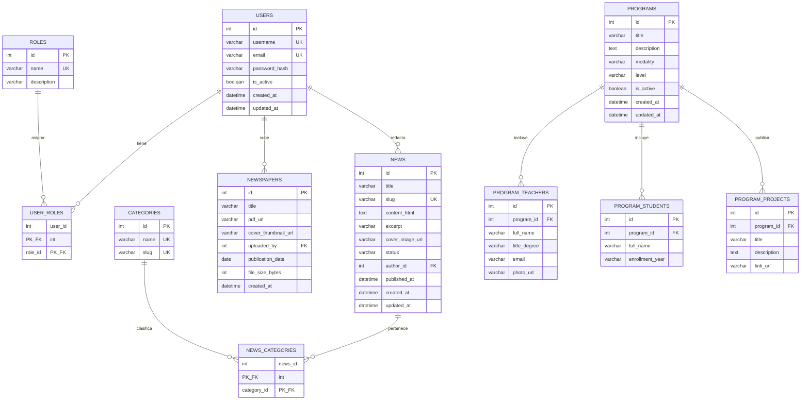

# 2.2 Modelo de base de datos — Portal CMS UPEC

**Motor:** MySQL 8.0, charset `utf8mb4`, collate `utf8mb4_unicode_ci`  
**ORM de implementación:** SQLAlchemy 2 (Python 3.12)  
**Formas normales objetivo:** 3FN (sin grupos repetitivos, sin dependencias parciales ni transitivas de atributos no clave)

---

## Prompt usado con la IA

```
A partir de estos requisitos genera un modelo ER y el DDL MySQL 8:

Entidades del análisis: Usuario {id, email, password_hash, rol, estado},
Noticia/Periódico {id, titulo, contenido_html, archivo_pdf_url, autor_id, fecha_publicacion},
Programa {id, titulo, descripcion, lista_docentes, lista_estudiantes, proyectos}.

Restricciones: solo @upec.edu.ec, RBAC (SuperAdmin, Editor, GestorProgramas),
noticias con HTML y portada, periódicos con PDF, programas con docentes,
estudiantes y proyectos destacados, categorías de noticias.

Evalúa normalización y justifica cada tabla.
```

---

## Evaluación del modelo generado por la IA (antes de corregir)

La IA, alineada con el análisis de la Parte 1, propuso **tres tablas planas**. Problemas:

| Problema | Por qué falla | Forma normal violada |
|---|---|---|
| `Usuario.rol` como un solo VARCHAR | Un usuario no podría ser Editor **y** Gestor; el requisito pide permisos granulares | 1FN débil / diseño RBAC incorrecto |
| `lista_docentes`, `lista_estudiantes`, `proyectos` como texto/JSON en `Programa` | Grupo repetitivo; no se puede consultar “en qué programas está el docente X” | **1FN** |
| Noticia y Periódico en la **misma** entidad | Un periódico no tiene `contenido_html`; una noticia no tiene `archivo_pdf_url` obligatorio. Atributos nulos sistemáticos | Diseño no cohesivo (mezcla de tipos) |
| Sin `categories` | RF-004 / portal filtra noticias | Entidad faltante |
| `password` en claro (en un borrador de la IA) | Inaceptable | Seguridad, no solo normalización |
| Videos de YouTube persistidos 1:1 sin necesidad | Duplican datos de Google y se vencen | Sobremodelado |

**Conclusión:** el modelo IA **no estaba normalizado** y **faltaban** `roles`, `user_roles`, `categories`, `news_categories`, `program_teachers`, `program_students`, `program_projects`. Tampoco distinguía noticia vs. periódico.

---

## Modelo ER final (corregido por el equipo)



### Cardinalidades

| Relación | Cardinalidad | Regla de negocio |
|---|---|---|
| User ↔ Role | N:M | Un staff puede acumular roles |
| User → News | 1:N | Toda noticia tiene un autor interno |
| News ↔ Category | N:M | Una noticia puede ir a varias secciones |
| User → Newspaper | 1:N | Quién subió el PDF |
| Program → Teacher / Student / Project | 1:N | Ficha RF-006; borrado en cascada del programa |

YouTube e Icecast **no** tienen tablas: son integraciones con caché en memoria / consulta en vivo (ver arquitectura).

---

## Justificación de normalización (modelo final)

- **1FN:** cada atributo es atómico; docentes/estudiantes/proyectos son filas, no listas.
- **2FN:** claves primarias simples o compuestas (`user_roles`, `news_categories`) sin atributos no clave que dependan de parte de la clave (las tablas puente solo tienen FKs).
- **3FN:** `username`/`email` no determinan `password_hash` de otro usuario; no hay atributos derivados persistidos (`teachers_count` se calcula en la API).
- **Integridad:** `ON DELETE CASCADE` en puentes y en hijos de programa; `author_id` / `uploaded_by` se conservan (RESTRICT implícito) para no borrar historia de contenidos al desactivar un usuario.
- **Dominio institucional:** `users.email` UNIQUE; la regla `@upec.edu.ec` se aplica en la capa API (no solo en CHECK), porque Flask ya valida en login y alta de usuario.

Roles semilla:

| `roles.name` | Uso |
|---|---|
| `superadmin` | RF-003 total |
| `editor` | RF-004 noticias y periódicos |
| `gestor_programas` | RF-006 directorio académico |

`news.status`: `draft` | `published` | `archived`. El GET público filtra `published`.

---

## DDL final

El script ejecutable está en [`schema.sql`](./schema.sql). Fragmento de las correcciones clave respecto al borrador IA:

```sql
-- IA proponía: programas.lista_docentes TEXT
-- Corrección 3FN:
CREATE TABLE program_teachers (
    id INT AUTO_INCREMENT PRIMARY KEY,
    program_id INT NOT NULL,
    full_name VARCHAR(200) NOT NULL,
    ...
    FOREIGN KEY (program_id) REFERENCES programs(id) ON DELETE CASCADE
);
```

---

## Trazabilidad requisitos → tablas

| Requisito | Tablas |
|---|---|
| REQ-003 / RF-003 | `users`, `roles`, `user_roles` |
| REQ-004 / RF-004 | `news`, `categories`, `news_categories`, `newspapers` |
| REQ-006 / RF-006 | `programs`, `program_teachers`, `program_students`, `program_projects` |
| REQ-010 | `users.email` + validación API; BD `upec_cms_db` |
